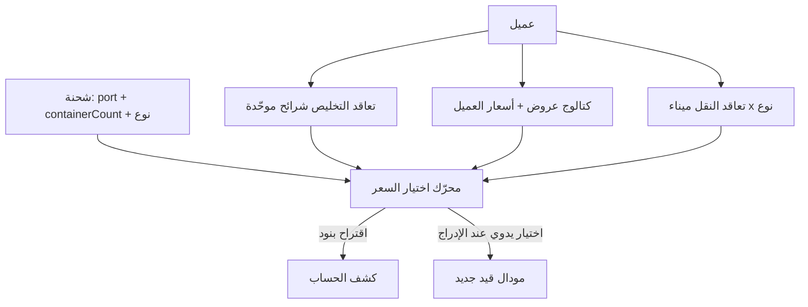

# تسعير تعاقد العميل وربطه بالشحنة / الكشف

## القرارات المثبتة

- التطبيق: **تلقائي + يدوي** معًا.
- شكل تعاقد التخليص: **موحّد لكل العملاء** (نفس الشرائح/المفاتيح؛ الأرقام فقط تختلف).
- **استبعاد** قسم «ملاحظات على تعاقد التخليص والنقل» من الـ PDF بالكامل.

## النموذج الموحّد (مستوحى من المشتركة بين PDF الدولية وPDF فابريك)

### أ) رأس التعاقد (بيانات على العميل أو جدول `client_contracts`)

تاريخ سريان، مدة (مثلًا عام)، نوع التعاقد (تخليص / نقل / تخليص ونقل)، الموانئ المشمولة — للعرض والتوثيق فقط.

### ب) تعاقد التخليص — شرائح موحّدة

قالب ثابت لكل عميل (صفوف جاهزة، المستخدم يملأ السعر أو يتركه فارغ/معطّل):

| مفتاح الشريحة     | المعنى                           |
| ----------------- | -------------------------------- |
| `qty_1` … `qty_5` | حاوية واحدة … خمس                |
| `qty_6_10`        | 6–10                             |
| `qty_11_15`       | 11–15                            |
| `qty_16_20`       | 16–20                            |
| `qty_21_50`       | 21–50                            |
| `lcl`             | شحنات LCL                        |
| `extra_unit`      | حاوية إضافية (بعد الأولى) إن لزم |

اختياري لاحقًا بنفس الجدول: بعد `unit_type` (`20ft` / `40ft`) لو الشحنة حددت النوع — للمرحلة الأولى يكفي العدد + LCL/إضافية لتغطية الشكل الموحّد.

### ج) العروض — قائمة أساسية قابلة للزيادة/النقص

كتالوج نظامي (X-Ray، أمن عام، دمغة، سلامة غذاء، كيمياء، واردات/لجنة أسعار، طاقة ذرية، مخابرات، حماية مدنية، …) + إمكانية إضافة عرض مخصص للعميل. كل صف: مفعّل؟ + سعر.

### د) تعاقد النقل — صفوف موحّدة قابلة للتخصيص

مصفوفة: **ميناء** (إسكندرية / سخنة عبر `ports` أو مفتاح ثابت) × **نوع** (20، 40، جامبو، دبابة، نولون 2×20، …) → سعر. المستخدم يعطّل صف أو يضيف صف نقل مخصص.

## التخزين (بدل `client_pricing` المسطح فقط)

جداول جديدة (أو استبدال تدريجي لمعنى التسعير؛ الإبقاء على `client_pricing` القديم للقراءة القديمة إن لزم دون كسر):

- `client_contract_meta` — رأس التعاقد
- `client_clearance_rates` — `client_id`, `tier_key`, `amount`, `currency`, `is_active`
- `client_offer_rates` — `client_id`, `offer_key` أو `custom_label`, `amount`, `currency`, `is_active`
- `client_transport_rates` — `client_id`, `port_id` أو `port_key`, `unit_key`, `amount`, `currency`, `is_active`

Migrations: `ADD` / `CREATE` فقط — بدون حذف بيانات العملاء الحالية.

## الربط بالشحنة والكشف

- الشحنة أصلًا فيها `portId` و `containerCount` ([`app/shipments/page.tsx`](app/shipments/page.tsx)).
- **تلقائي:** في [`app/statements/page.tsx`](app/statements/page.tsx) زر «تطبيق أسعار التعاقد» على الكشف المحدد → يقترح بنود (تخليص حسب شريحة العدد، نقل حسب الميناء إن وُجدت تسعيرة، عروض مفعّلة إن اختارها المستخدم في حوار قصير أو تُترك للاختيار اليدوي).
- **يدوي:** في مودال إدراج القيد: قائمة من أسعار هذا العميل (تخليص/عرض/نقل) تملأ الوصف والمبلغ؛ مع الإبقاء على الربط بـ `client_item_id` لأصناف البضاعة كما أُنجز.

محرّك الحل في API مثل `GET/POST /api/clients/[id]/pricing` و `POST /api/statements/suggest-pricing`.

## UI العملاء

استبدال محرّر «اتفاقية تسعير» الحر في [`app/clients/page.tsx`](app/clients/page.tsx) بثلاثة أقسام مجدولة (تخليص / عروض / نقل) بنفس شكل PDF بدون قسم الملاحظات.

## خارج النطاق لهذه المرحلة

- استيراد PDF تلقائي.
- ضريبة القيمة المضافة كمحرك محاسبي منفصل (تُدار كبنود/نسب لاحقًا إن طُلب).
- ملاحظات التعاقد من الـ PDF.
